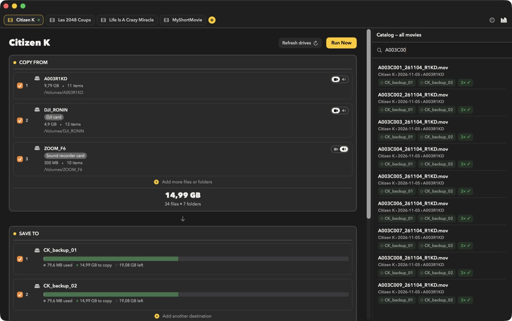

<!-- lang:en -->
# Catalog

FilmCan remembers every roll it backs up: which drives hold it and which clips it contains.
Open it with **Shift+Cmd+K**, Window › Catalog, or the books icon in the top bar. It opens in the right pane of the main window, in the place of History (only one of the two is shown at a time); drag its edge to resize it (250 to 420 pt). **Window › Open Catalog in Window** opens it in a separate window instead.

---

## What it records

After each run that copied something, the catalog stores per roll: project, shoot day, roll name,
Camera/Sound kind, source volume, the clip list (relative path and size) and one entry per
destination drive (volume UUID, name, roll folder, verified or not). A run where everything was already backed up records nothing.

The file lives at `~/Library/Application Support/FilmCan/catalog.json`. A corrupt file is renamed
to `catalog.json.corrupt-<timestamp>` and the catalog starts empty; the previous save is kept as
`catalog.json.bak`.

---

## Coverage

A roll is safe ("2× ✓") when it sits on **two or more distinct drives with a passed verify**.
Drives are told apart by volume UUID, never by name, so two drives both called "Untitled" count
as two. Two folders on the same drive count once. Unverified copies do not count: a copy is verified only when the run succeeded and Verification was not set to Off.

- Green "N× ✓": at least two verified drives.
- Orange "1 drive only": one verified drive. Copy the roll to a second drive before formatting the card.
- Grey "Not verified": copies exist, none verified.

An orange banner at the top of the list counts the rolls that are on one drive only. An orange dot on the toolbar button means at least one roll is not yet safe. A filled dot on a
drive chip means the drive is connected. A roll whose clip list was not recorded shows "Files not indexed" instead of a file count.

---

## Search

Type a clip name (for example `C0042`) in the search field. Matching is case-insensitive on the
file name. Each hit shows project, day, roll and the drives holding it, even if a drive is unplugged.
Results are capped at 200.

Click a connected drive chip to reveal the roll folder on that drive in the Finder; in search results it reveals the clip itself. Double-clicking a hit reveals the clip on the first connected drive.

---

## Context menu

- **Reveal on** `<drive>`: one entry per drive holding a copy. A drive that is unplugged is greyed out and marked "(not connected)".
- **Forget this roll**: removes the roll from the catalog after a confirmation; no file is deleted.

---

## Limits

Only runs made with this version are recorded. Drives backed up earlier are not listed.

<!-- lang:fr -->
# Catalog

FilmCan se souvient de chaque roll sauvegardé : quels disques le contiennent et quels clips il comprend.
Ouvrez-le avec **Shift+Cmd+K**, Window › Catalog, ou l'icône de livres dans la barre du haut. Il s'ouvre dans le volet droit de la fenêtre principale, à la place de History (un seul des deux est affiché à la fois) ; faites glisser son bord pour le redimensionner (250 à 420 pt). **Window › Open Catalog in Window** l'ouvre plutôt dans une fenêtre séparée.

---

## Ce qu'il enregistre

Après chaque exécution qui a copié quelque chose, le catalog stocke pour chaque roll : le projet, le jour de tournage, le nom du roll,
le type Camera/Sound, le volume source, la liste des clips (chemin relatif et taille) et une entrée par
disque de destination (UUID du volume, nom, dossier du roll, vérifié ou non). Une exécution où tout était déjà sauvegardé n'enregistre rien.

Le fichier se trouve dans `~/Library/Application Support/FilmCan/catalog.json`. Un fichier corrompu est renommé
en `catalog.json.corrupt-<timestamp>` et le catalog repart vide ; la sauvegarde précédente est conservée sous
`catalog.json.bak`.

---

## Couverture

Un roll est en sécurité (« 2× ✓ ») quand il se trouve sur **au moins deux disques distincts avec une vérification réussie**.
Les disques se distinguent par l'UUID du volume, jamais par le nom : deux disques appelés tous deux « Untitled » comptent
pour deux. Deux dossiers sur le même disque comptent pour un. Les copies non vérifiées ne comptent pas : une copie n'est vérifiée que si l'exécution a réussi et que Verification n'était pas sur Off.

- « N× ✓ » vert : au moins deux disques vérifiés.
- « 1 drive only » orange : un seul disque vérifié. Copiez le roll sur un second disque avant de formater la carte.
- « Not verified » gris : des copies existent, aucune n'est vérifiée.

Une bannière orange en haut de la liste compte les rolls présents sur un seul disque. Un point orange sur le bouton de la barre d'outils signifie qu'au moins un roll n'est pas encore en sécurité. Un point plein sur une
pastille de disque signifie que le disque est connecté. Un roll dont la liste de clips n'a pas été enregistrée affiche « Files not indexed » au lieu d'un nombre de fichiers.

---

## Recherche

Saisissez un nom de clip (par exemple `C0042`) dans le champ de recherche. La correspondance ne tient pas compte de la casse et porte sur le
nom du fichier. Chaque résultat affiche le projet, le jour, le roll et les disques qui le contiennent, même si un disque est débranché.
Les résultats sont limités à 200.

Cliquez sur une pastille de disque connecté pour afficher le dossier du roll sur ce disque dans le Finder ; dans les résultats de recherche, elle affiche le clip lui-même. Un double-clic sur un résultat affiche le clip sur le premier disque connecté.

---

## Menu contextuel

- **Reveal on** `<drive>` : une entrée par disque contenant une copie. Un disque débranché est grisé et marqué « (not connected) ».
- **Forget this roll** : retire le roll du catalog après confirmation ; aucun fichier n'est supprimé.

---

## Limites

Seules les exécutions faites avec cette version sont enregistrées. Les disques sauvegardés auparavant ne sont pas listés.

<!-- lang:de -->
# Catalog

FilmCan merkt sich jeden gesicherten Roll: welche Laufwerke ihn enthalten und welche Clips er umfasst.
Öffnen Sie ihn mit **Shift+Cmd+K**, Window › Catalog oder dem Bücher-Symbol in der oberen Leiste. Er öffnet sich im rechten Bereich des Hauptfensters, anstelle von History (es ist immer nur einer der beiden sichtbar); ziehen Sie an seinem Rand, um die Breite zu ändern (250 bis 420 pt). **Window › Open Catalog in Window** öffnet ihn stattdessen in einem eigenen Fenster.

---

## Was aufgezeichnet wird

Nach jedem Durchlauf, der etwas kopiert hat, speichert der Catalog pro Roll: Projekt, Drehtag, Roll-Name,
Art Camera/Sound, Quellvolume, die Clipliste (relativer Pfad und Größe) und einen Eintrag pro
Ziellaufwerk (Volume-UUID, Name, Roll-Ordner, verifiziert oder nicht). Ein Durchlauf, bei dem bereits alles gesichert war, zeichnet nichts auf.

Die Datei liegt unter `~/Library/Application Support/FilmCan/catalog.json`. Eine beschädigte Datei wird
in `catalog.json.corrupt-<timestamp>` umbenannt und der Catalog beginnt leer; der vorherige Stand bleibt als
`catalog.json.bak` erhalten.

---

## Abdeckung

Ein Roll ist sicher („2× ✓“), wenn er auf **mindestens zwei verschiedenen Laufwerken mit bestandener Verifizierung** liegt.
Laufwerke werden über die Volume-UUID unterschieden, nie über den Namen: Zwei Laufwerke, die beide „Untitled“ heißen, zählen
als zwei. Zwei Ordner auf demselben Laufwerk zählen einfach. Nicht verifizierte Kopien zählen nicht: Eine Kopie gilt nur als verifiziert, wenn der Durchlauf erfolgreich war und Verification nicht auf Off stand.

- Grünes „N× ✓“: mindestens zwei verifizierte Laufwerke.
- Oranges „1 drive only“: ein verifiziertes Laufwerk. Kopieren Sie den Roll auf ein zweites Laufwerk, bevor Sie die Karte formatieren.
- Graues „Not verified“: Kopien vorhanden, keine verifiziert.

Ein oranges Banner oben in der Liste zählt die Rolls, die nur auf einem Laufwerk liegen. Ein oranger Punkt auf der Symbolleisten-Schaltfläche bedeutet, dass mindestens ein Roll noch nicht sicher ist. Ein gefüllter Punkt auf einem
Laufwerks-Chip bedeutet, dass das Laufwerk verbunden ist. Ein Roll, dessen Clipliste nicht erfasst wurde, zeigt „Files not indexed“ statt einer Dateianzahl.

---

## Suche

Geben Sie einen Clipnamen (zum Beispiel `C0042`) in das Suchfeld ein. Der Abgleich ist beim
Dateinamen unabhängig von Groß- und Kleinschreibung. Jeder Treffer zeigt Projekt, Tag, Roll und die Laufwerke, die ihn enthalten, auch wenn ein Laufwerk abgesteckt ist.
Die Ergebnisse sind auf 200 begrenzt.

Ein Klick auf einen Chip eines verbundenen Laufwerks zeigt den Roll-Ordner auf diesem Laufwerk im Finder; in den Suchergebnissen zeigt er den Clip selbst. Ein Doppelklick auf einen Treffer zeigt den Clip auf dem ersten verbundenen Laufwerk.

---

## Kontextmenü

- **Reveal on** `<drive>`: ein Eintrag pro Laufwerk, das eine Kopie enthält. Ein abgestecktes Laufwerk ist ausgegraut und mit „(not connected)“ markiert.
- **Forget this roll**: entfernt den Roll nach einer Bestätigung aus dem Catalog; es wird keine Datei gelöscht.

---

## Grenzen

Nur Durchläufe mit dieser Version werden aufgezeichnet. Früher gesicherte Laufwerke werden nicht aufgeführt.

<!-- lang:es -->
# Catalog

FilmCan recuerda cada roll que respalda: qué unidades lo contienen y qué clips incluye.
Ábralo con **Shift+Cmd+K**, Window › Catalog o el icono de libros de la barra superior. Se abre en el panel derecho de la ventana principal, en lugar de History (solo se muestra uno de los dos a la vez); arrastre su borde para cambiar el tamaño (de 250 a 420 pt). **Window › Open Catalog in Window** lo abre en cambio en una ventana aparte.

---

## Qué registra

Tras cada ejecución que copió algo, el catalog guarda por roll: proyecto, día de rodaje, nombre del roll,
tipo Camera/Sound, volumen de origen, la lista de clips (ruta relativa y tamaño) y una entrada por
unidad de destino (UUID del volumen, nombre, carpeta del roll, verificado o no). Una ejecución en la que todo ya estaba respaldado no registra nada.

El archivo está en `~/Library/Application Support/FilmCan/catalog.json`. Un archivo dañado se renombra
a `catalog.json.corrupt-<timestamp>` y el catalog empieza vacío; el guardado anterior se conserva como
`catalog.json.bak`.

---

## Cobertura

Un roll está seguro («2× ✓») cuando está en **dos o más unidades distintas con una verificación superada**.
Las unidades se distinguen por el UUID del volumen, nunca por el nombre: dos unidades llamadas ambas «Untitled» cuentan
como dos. Dos carpetas en la misma unidad cuentan como una. Las copias sin verificar no cuentan: una copia solo está verificada si la ejecución tuvo éxito y Verification no estaba en Off.

- «N× ✓» verde: al menos dos unidades verificadas.
- «1 drive only» naranja: una unidad verificada. Copie el roll a una segunda unidad antes de formatear la tarjeta.
- «Not verified» gris: hay copias, ninguna verificada.

Un aviso naranja en la parte superior de la lista cuenta los rolls que están en una sola unidad. Un punto naranja en el botón de la barra de herramientas indica que al menos un roll aún no está seguro. Un punto relleno en un
chip de unidad indica que la unidad está conectada. Un roll cuya lista de clips no se registró muestra «Files not indexed» en lugar de un número de archivos.

---

## Búsqueda

Escriba el nombre de un clip (por ejemplo `C0042`) en el campo de búsqueda. La coincidencia no distingue mayúsculas de minúsculas y se aplica al
nombre del archivo. Cada resultado muestra proyecto, día, roll y las unidades que lo contienen, aunque una unidad esté desconectada.
Los resultados están limitados a 200.

Haga clic en el chip de una unidad conectada para mostrar la carpeta del roll en esa unidad en el Finder; en los resultados de búsqueda muestra el propio clip. Un doble clic en un resultado muestra el clip en la primera unidad conectada.

---

## Menú contextual

- **Reveal on** `<drive>`: una entrada por unidad que contiene una copia. Una unidad desconectada aparece atenuada y marcada «(not connected)».
- **Forget this roll**: quita el roll del catalog tras una confirmación; no se elimina ningún archivo.

---

## Límites

Solo se registran las ejecuciones hechas con esta versión. Las unidades respaldadas antes no aparecen.
