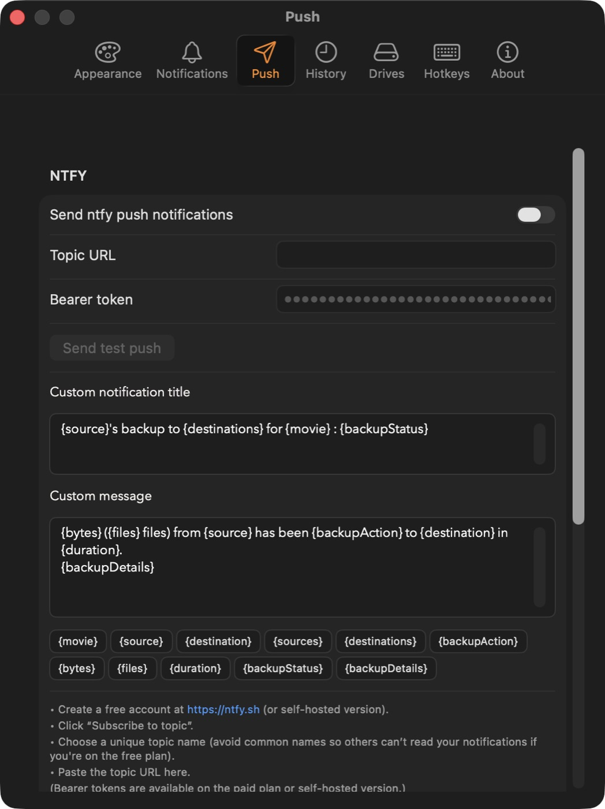

<!-- lang:en -->
# Push Notifications

Get alerts when backups finish or fail.

---

## Limitations

- Notifications are sent only to the endpoint you configure.
- If the endpoint is offline, messages may be lost.

---

## macOS Notifications

1. Enable in FilmCan **Settings**
2. Configure style in **System Settings** > **Notifications** > FilmCan

---

## Phone, by QR code

No account and nothing to type.

1. FilmCan **Settings** › **Push** › turn on **Send notifications to my phone**. A QR code appears.
2. Scan it with your phone's camera. The page that opens has two steps: install the free ntfy app, then subscribe to your channel.
3. Back in FilmCan, click **Send a test**.

- FilmCan invents a long random channel name for you. Anyone who knows it can read your notifications, so keep it to yourself. **New code…** replaces it; phones must then scan again.
- The channel name is also shown next to the QR code, to subscribe by hand in the ntfy app.
- The public ntfy.sh server limits how many messages one network may send per day. A test that answers "HTTP 429" means that limit was reached; wait and retry.
- The name is kept in FilmCan's preferences, so it survives app updates.

---

## ntfy with your own topic or server

Open **Advanced** in Settings › Push and turn on **Use my own ntfy server or topic**. If you had filled a Topic URL in an earlier version, this is already on and nothing changed for you.



1. Create a free account at https://ntfy.sh (or use a self‑hosted ntfy) and install the app on your phone.
2. Create a topic: e.g. `ntfy.sh/mymovie_backup`
3. Paste the topic URL in the **Topic URL** field in FilmCan **Settings**
4. (Optional) Paste a **Bearer token** if your topic requires auth

---

## Webhook

Send a JSON payload to your own endpoint (Discord, Slack, custom server, etc.).

1. Enable **Webhook** in FilmCan **Settings**
2. Paste your **Webhook URL**
3. (Optional) Add **Custom headers** (one per line, `Header: Value`)

Payload format:
```
{
  "title": "...",
  "message": "...",
  "fields": {
    "movie": "...",
    "source": "...",
    "destination": "...",
    "sources": "...",
    "destinations": "...",
    "backupAction": "...",
    "bytes": "...",
    "files": "...",
    "duration": "...",
    "backupStatus": "...",
    "backupDetails": "..."
  }
}
```

The **title** and **message** use the same templates as ntfy. Use custom headers to add auth tokens (e.g., `Authorization: Bearer <token>`).

---

## What You'll Get

- Backup complete / failed (per destination)

---

## Troubleshooting

**No macOS alerts**  
**System Settings** > **Notifications** > FilmCan

**ntfy not working**  
Check topic URL and internet connection

**"FilmCan wants to access your confidential information" after an update**  
This is expected, and it is about your **ntfy bearer token**. The token is stored in your
macOS keychain, and the keychain ties access to the exact copy of the app that saved it.
A new version is a different copy, so macOS asks you to confirm once. Click **Always
Allow** and the token works again until the next update. Your token is not lost.

If you clicked **Deny**, or if the dialog never appeared, FilmCan sees no token and the
field in Settings looks empty: paste the token again and it will be saved normally.

Removing the prompt entirely would require signing FilmCan with a paid Apple certificate,
which would publish the developer's legal name and email inside the app. That trade is
deliberately not made.

**Webhook not working**  
Check URL, SSL/TLS, and your endpoint logs

---

## Related

- [Transfer History](./transfer-history.md)

<!-- lang:fr -->
# Notifications push

Recevez des alertes lorsque les backups se terminent ou échouent.

---

## Limitations

- Les notifications sont envoyées uniquement à l'endpoint que vous configurez.
- Si l'endpoint est hors ligne, les messages peuvent être perdus.

---

## Notifications macOS

1. Activez dans FilmCan **Settings**
2. Configurez le style dans **System Settings** > **Notifications** > FilmCan

---

## Téléphone, par QR code

Sans compte et sans rien taper.

1. FilmCan **Settings** › **Push** › activez **Send notifications to my phone**. Un QR code apparaît.
2. Scannez-le avec l'appareil photo de votre téléphone. La page qui s'ouvre a deux étapes : installer l'application gratuite ntfy, puis vous abonner à votre canal.
3. De retour dans FilmCan, cliquez sur **Send a test**.

- FilmCan invente pour vous un long nom de canal aléatoire. Toute personne qui le connaît peut lire vos notifications : gardez-le pour vous. **New code…** le remplace ; les téléphones doivent alors scanner de nouveau.
- Le nom du canal est aussi affiché à côté du QR code, pour vous abonner à la main dans l'application ntfy.
- Le serveur public ntfy.sh limite le nombre de messages qu'un réseau peut envoyer par jour. Un test qui répond « HTTP 429 » signifie que cette limite est atteinte ; attendez puis réessayez.
- Le nom est conservé dans les préférences de FilmCan : il survit aux mises à jour de l'application.

---

## ntfy avec votre propre sujet ou serveur

Ouvrez **Advanced** dans Settings › Push et activez **Use my own ntfy server or topic**. Si vous aviez rempli un Topic URL dans une version précédente, c'est déjà activé et rien n'a changé pour vous.


1. Créez un compte gratuit sur https://ntfy.sh (ou utilisez un ntfy auto-hébergé) et installez l'application sur votre téléphone.
2. Créez un sujet : par ex. `ntfy.sh/mymovie_backup`
3. Collez l'URL du sujet dans le champ **Topic URL** de FilmCan **Settings**
4. (Optionnel) Collez un **Bearer token** si votre sujet nécessite une authentification

---

## Webhook

Envoyez une charge utile JSON à votre propre endpoint (Discord, Slack, serveur personnalisé, etc.).

1. Activez **Webhook** dans FilmCan **Settings**
2. Collez votre **Webhook URL**
3. (Optionnel) Ajoutez des **Custom headers** (un par ligne, `Header: Value`)

Format de charge utile :
```
{
  "title": "...",
  "message": "...",
  "fields": {
    "movie": "...",
    "source": "...",
    "destination": "...",
    "sources": "...",
    "destinations": "...",
    "backupAction": "...",
    "bytes": "...",
    "files": "...",
    "duration": "...",
    "backupStatus": "...",
    "backupDetails": "..."
  }
}
```

Le **title** et le **message** utilisent les mêmes modèles que ntfy. Utilisez des en-têtes personnalisés pour ajouter des jetons d'authentification (par ex., `Authorization: Bearer <token>`).

---

## Ce que vous obtiendrez

- Backup terminé/échoué (par destination)

---

## Dépannage

**Pas d'alertes macOS**  
**System Settings** > **Notifications** > FilmCan

**ntfy ne fonctionne pas**  
Vérifiez l'URL du sujet et la connexion Internet

**« FilmCan souhaite accéder à vos informations confidentielles » après une mise à jour**  
C'est normal, et cela concerne votre **jeton ntfy**. Le jeton est conservé dans le
trousseau macOS, qui lie l'accès à la copie exacte de l'application qui l'a enregistré.
Une nouvelle version est une copie différente : macOS demande donc une confirmation, une
seule fois. Cliquez sur **Toujours autoriser** et le jeton refonctionne jusqu'à la
prochaine mise à jour. Votre jeton n'est pas perdu.

Si vous avez cliqué sur **Refuser**, ou si la fenêtre ne s'est jamais affichée, FilmCan ne
voit aucun jeton et le champ des réglages paraît vide : recollez le jeton, il sera
enregistré normalement.

Supprimer complètement cette fenêtre exigerait de signer FilmCan avec un certificat Apple
payant, ce qui publierait le nom légal et l'adresse e-mail du développeur à l'intérieur de
l'application. Ce compromis n'est volontairement pas fait.

**Webhook ne fonctionne pas**  
Vérifiez l'URL, SSL/TLS et les journaux de votre endpoint

---

## Liens

- [Transfer History](./transfer-history.md)

<!-- lang:de -->
# Push-Benachrichtigungen

Erhalten Sie Benachrichtigungen, wenn Backups abgeschlossen sind oder fehlschlagen.

---

## Einschränkungen

- Benachrichtigungen werden nur an den Endpoint gesendet, den Sie konfigurieren.
- Wenn der Endpoint offline ist, können Nachrichten verloren gehen.

---

## macOS-Benachrichtigungen

1. Aktivieren Sie in FilmCan **Settings**
2. Konfigurieren Sie den Stil in **System Settings** > **Notifications** > FilmCan

---

## Telefon, per QR-Code

Ohne Konto und ohne etwas einzutippen.

1. FilmCan **Settings** › **Push** › schalten Sie **Send notifications to my phone** ein. Ein QR-Code erscheint.
2. Scannen Sie ihn mit der Kamera Ihres Telefons. Die Seite, die sich öffnet, hat zwei Schritte: die kostenlose ntfy-App installieren, dann Ihren Kanal abonnieren.
3. Klicken Sie in FilmCan auf **Send a test**.

- FilmCan erfindet für Sie einen langen zufälligen Kanalnamen. Wer ihn kennt, kann Ihre Benachrichtigungen lesen: Behalten Sie ihn für sich. **New code…** ersetzt ihn; Telefone müssen dann erneut scannen.
- Der Kanalname steht auch neben dem QR-Code, um ihn von Hand in der ntfy-App zu abonnieren.
- Der öffentliche Server ntfy.sh begrenzt, wie viele Nachrichten ein Netzwerk pro Tag senden darf. Ein Test mit der Antwort „HTTP 429“ bedeutet, dass diese Grenze erreicht ist; warten Sie und versuchen Sie es erneut.
- Der Name liegt in den Einstellungen von FilmCan und übersteht App-Updates.

---

## ntfy mit eigenem Thema oder Server

Öffnen Sie **Advanced** in Settings › Push und schalten Sie **Use my own ntfy server or topic** ein. Wenn Sie in einer früheren Version eine Topic URL eingetragen hatten, ist das bereits an und für Sie hat sich nichts geändert.


1. Erstellen Sie ein kostenloses Konto unter https://ntfy.sh (oder verwenden Sie eine selbst gehostete ntfy) und installieren Sie die App auf Ihrem Telefon.
2. Erstellen Sie ein Thema: z. B. `ntfy.sh/mymovie_backup`
3. Fügen Sie die Thema-URL in das Feld **Topic URL** in FilmCan **Settings** ein
4. (Optional) Fügen Sie ein **Bearer token** ein, wenn Ihr Thema Authentifizierung erfordert

---

## Webhook

Senden Sie eine JSON-Nutzlast an Ihren eigenen Endpoint (Discord, Slack, benutzerdefinierter Server usw.).

1. Aktivieren Sie **Webhook** in FilmCan **Settings**
2. Fügen Sie Ihre **Webhook URL** ein
3. (Optional) Fügen Sie **Custom headers** hinzu (eine pro Zeile, `Header: Value`)

Nutzlastformat:
```
{
  "title": "...",
  "message": "...",
  "fields": {
    "movie": "...",
    "source": "...",
    "destination": "...",
    "sources": "...",
    "destinations": "...",
    "backupAction": "...",
    "bytes": "...",
    "files": "...",
    "duration": "...",
    "backupStatus": "...",
    "backupDetails": "..."
  }
}
```

Der **title** und die **message** verwenden dieselben Vorlagen wie ntfy. Verwenden Sie benutzerdefinierte Header, um Authentifizierungstoken hinzuzufügen (z. B. `Authorization: Bearer <token>`).

---

## Was Sie erhalten

- Backup abgeschlossen/fehlgeschlagen (pro Ziel)

---

## Fehlerbehebung

**Keine macOS-Benachrichtigungen**  
**System Settings** > **Notifications** > FilmCan

**ntfy funktioniert nicht**  
Überprüfen Sie Thema-URL und Internetverbindung

**„FilmCan möchte auf Ihre vertraulichen Informationen zugreifen" nach einem Update**  
Das ist normal und betrifft Ihren **ntfy-Token**. Der Token liegt im macOS-Schlüsselbund,
und der Schlüsselbund bindet den Zugriff an genau die Kopie der App, die ihn gespeichert
hat. Eine neue Version ist eine andere Kopie, deshalb fragt macOS einmal nach. Klicken Sie
auf **Immer erlauben**, dann funktioniert der Token bis zum nächsten Update. Ihr Token
geht nicht verloren.

Wenn Sie **Ablehnen** geklickt haben oder der Dialog nie erschien, sieht FilmCan keinen
Token und das Feld in den Einstellungen wirkt leer: Fügen Sie den Token erneut ein, er
wird normal gespeichert.

Den Dialog ganz zu entfernen würde ein kostenpflichtiges Apple-Zertifikat erfordern,
wodurch der bürgerliche Name und die E-Mail-Adresse des Entwicklers in der App
veröffentlicht würden. Dieser Kompromiss wird bewusst nicht eingegangen.

**Webhook funktioniert nicht**  
Überprüfen Sie URL, SSL/TLS und Ihre Endpoint-Protokolle

---

## Links

- [Transfer History](./transfer-history.md)

<!-- lang:es -->
# Notificaciones push

Reciba alertas cuando los backups se completen o fallen.

---

## Limitaciones

- Las notificaciones se envían solo al endpoint que configura.
- Si el endpoint está desconectado, los mensajes pueden perderse.

---

## Notificaciones de macOS

1. Habilite en FilmCan **Settings**
2. Configure el estilo en **System Settings** > **Notifications** > FilmCan

---

## Teléfono, por código QR

Sin cuenta y sin escribir nada.

1. FilmCan **Settings** › **Push** › active **Send notifications to my phone**. Aparece un código QR.
2. Escanéelo con la cámara de su teléfono. La página que se abre tiene dos pasos: instalar la aplicación gratuita ntfy y suscribirse a su canal.
3. De vuelta en FilmCan, haga clic en **Send a test**.

- FilmCan inventa para usted un nombre de canal largo y aleatorio. Cualquiera que lo conozca puede leer sus notificaciones: no lo comparta. **New code…** lo reemplaza; los teléfonos deben escanear de nuevo.
- El nombre del canal también se muestra junto al código QR, para suscribirse a mano en la aplicación ntfy.
- El servidor público ntfy.sh limita cuántos mensajes puede enviar una red por día. Una prueba que responde «HTTP 429» significa que se alcanzó ese límite; espere y vuelva a intentarlo.
- El nombre se guarda en las preferencias de FilmCan, así que sobrevive a las actualizaciones.

---

## ntfy con su propio tema o servidor

Abra **Advanced** en Settings › Push y active **Use my own ntfy server or topic**. Si había rellenado un Topic URL en una versión anterior, ya está activado y nada ha cambiado para usted.


1. Cree una cuenta gratuita en https://ntfy.sh (o use un ntfy autoalojado) e instale la aplicación en su teléfono.
2. Cree un tema: por ejemplo, `ntfy.sh/mymovie_backup`
3. Pegue la URL del tema en el campo **Topic URL** de FilmCan **Settings**
4. (Opcional) Pegue un **Bearer token** si su tema requiere autenticación

---

## Webhook

Envíe una carga JSON a su propio endpoint (Discord, Slack, servidor personalizado, etc.).

1. Habilite **Webhook** en FilmCan **Settings**
2. Pegue su **Webhook URL**
3. (Opcional) Agregue **Custom headers** (una por línea, `Header: Value`)

Formato de carga:
```
{
  "title": "...",
  "message": "...",
  "fields": {
    "movie": "...",
    "source": "...",
    "destination": "...",
    "sources": "...",
    "destinations": "...",
    "backupAction": "...",
    "bytes": "...",
    "files": "...",
    "duration": "...",
    "backupStatus": "...",
    "backupDetails": "..."
  }
}
```

El **title** y el **message** utilizan las mismas plantillas que ntfy. Utilice encabezados personalizados para agregar tokens de autenticación (por ejemplo, `Authorization: Bearer <token>`).

---

## Lo que obtendrá

- Backup completado/fallido (por destino)

---

## Resolución de problemas

¿No hay alertas de macOS?  
**System Settings** > **Notifications** > FilmCan

¿ntfy no funciona?  
Verifique la URL del tema y la conexión a Internet

«FilmCan quiere acceder a su información confidencial» tras una actualización  
Es normal y se refiere a su **token de ntfy**. El token se guarda en el llavero de macOS,
que vincula el acceso a la copia exacta de la aplicación que lo guardó. Una versión nueva
es una copia distinta, así que macOS pide confirmación una sola vez. Pulse **Permitir
siempre** y el token vuelve a funcionar hasta la próxima actualización. Su token no se ha
perdido.

Si pulsó **Denegar**, o si la ventana nunca apareció, FilmCan no ve ningún token y el
campo de los ajustes parece vacío: vuelva a pegar el token y se guardará con normalidad.

Eliminar por completo esa ventana exigiría firmar FilmCan con un certificado de Apple de
pago, lo que publicaría el nombre legal y el correo del desarrollador dentro de la
aplicación. Ese intercambio no se hace de forma deliberada.

¿Webhook no funciona?  
Verifique la URL, SSL/TLS y sus registros de endpoint

---

## Relacionado

- [Transfer History](./transfer-history.md)
