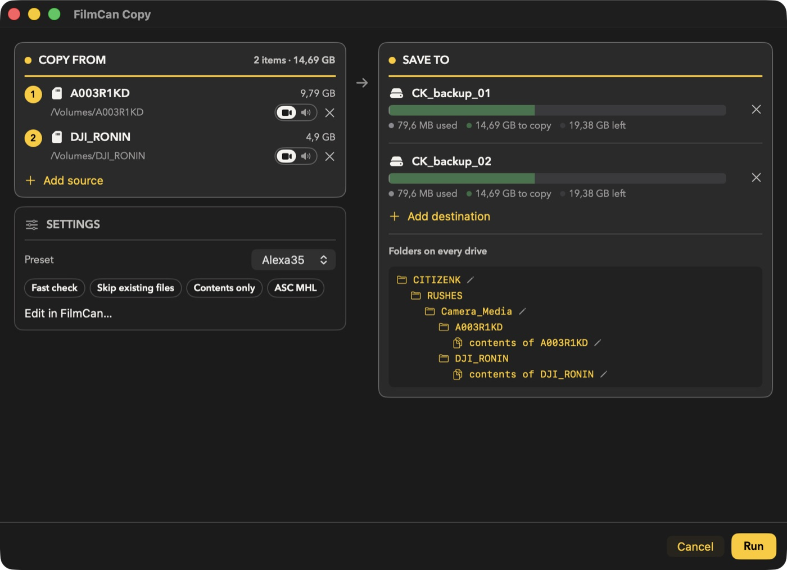
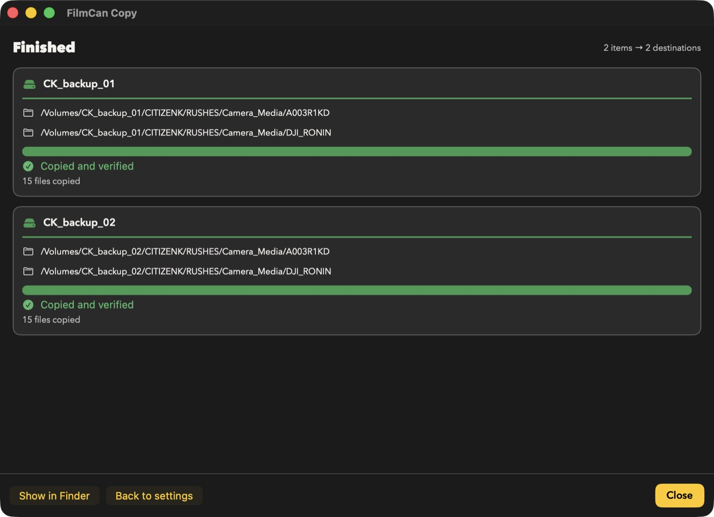

<!-- lang:en -->
# Quick Copy (Finder)

Copy files or folders straight from the Finder with the FilmCan engine, without opening the main FilmCan window.

---

## Start a Quick Copy

1. In the Finder, select one or more files or folders.
2. Right-click, then choose **Services → FilmCan Copy**. You can also drop the selection on the FilmCan icon in the Dock.
3. A small window opens. The main FilmCan window does not appear.

If **FilmCan Copy** is missing from the menu, open FilmCan once so macOS registers it. Then check **System Settings → Keyboard → Keyboard Shortcuts → Services → Files and Folders** and tick **FilmCan Copy**.

Each request opens its own window, so two selections run side by side.

---

## The setup window

The window is about 900 pt wide and has two columns: **Copy From** and **Settings** on the left, **Save To** on the right.

- **Copy From**: your selection. Each row shows the full name and size, then the path. When folders are organized, each row also has a **Camera / Sound** switch (click either side to flip it), pre-filled from the content (an item is Sound when most of its files are audio), and an **x** to remove the source.
- **Save To**: one destination to start. Click **Add destination** for more, or drop folders or drives on the card. Drop files or folders on **Copy From** to add sources. The source is read once and written to every destination. Each destination shows a capacity bar (used, to copy, free, left to right) with a legend.
- **Film** (in **Settings**): pick one of your films (the tabs of the main window) or **None**. With a film, the copy appears in that film's History tab and under its name in the Catalog, and the window loads the film's preset, project and day; a line below reminds you which preset the film uses. You can still change the preset for this copy only. Without a film, the Catalog files the copy under the typed project, or under *Quick Copy*.
- **Preset** (in **Settings**): pick **None** or one of your saved organization presets. With a preset, the window shows its options as chips (for example *Paranoid check*, *Skip existing files*, *Whole folder* or *Contents only*, *ASC MHL*); hover them for details. A preset set to *Ask each time* runs as *Skip*.
- With **None**, the basic options are:
  - **Verification**: Fast (default), Paranoid or Off.
  - **If file exists**: Skip (default), Overwrite, Add counter or Verify using hash list.
  - **Copy**: the folder (default) or its contents only.
  - **Organization**: None, Date only, or Project + day.
- **Organization** section (when organized): **Project** and **Day** (Day is optional), then a live preview of the folders that will be created, always fully expanded, new ones highlighted. One **Folders on every drive** tree is shown when all destinations get the same folders, otherwise one tree per drive. The top folder and the Camera/Sound folder (`Camera_Media`, `Sound_Media`) have a pencil: click it to rename that folder in place for this copy; the arrow restores the preset's name.
- **Save as preset**: type a name to keep these settings as a preset. Leave it empty to skip. A picked date is never saved.

Project and Day are cleaned before use: spaces and characters Netflix prohibits become `_`.

**Run** stays disabled until there is at least one destination that exists, and a Project name when the organization is *Project + day*.

---

## Folder layout

| Organization | Camera item `A001` | Sound item `ZOOM_F8` |
|--------------|--------------------|----------------------|
| None | `A001/` | `ZOOM_F8/` |
| Date only | `20261014/Camera_Media/A001/` | `20261014/Sound_Media/ZOOM_F8/` |
| Project + day | `20261014_Docu_Truc_itw/Camera_Media/A001/` | `20261014_Docu_Truc_itw/Sound_Media/ZOOM_F8/` |

Each roll gets its own `ascmhl` folder, like a normal backup.

---

## Progress and result

The setup window turns into the progress window. Each destination shows the copy bar (yellow) and the verify bar (green), speed, estimated time and the current file.

- **Stop** stops the copy cleanly. Nothing is deleted. Run Quick Copy again on the same selection and destination: only what is missing is copied.
- When it ends, each destination shows a green check (copied and verified) or a red message explaining the failure. One failing destination does not stop the others.
- Each destination card lists the folders the copy writes to (for example `…/Camera_Media`). Click one to open it in Finder, during or after the copy.
- **Show in Finder** opens the folder that was created.
- **Back to settings** returns to the setup window with the same choices, to copy again or change something.
- If everything was already present, the window says **Already backed up** and nothing is copied.

Closing the window during a copy asks whether to stop it.

---

## When FilmCan closes by itself

If FilmCan was not running and the Quick Copy started it, FilmCan quits when you close the last Quick Copy window. If FilmCan was already open, it stays open. Opening the main window yourself (for example with **Edit in FilmCan…**) also keeps it open.

---

## Good to know

- Quick Copy has **Stop**, but no Pause.
- Select **one loose file at a time**, or put several files in a folder. Several loose files in the same selection cannot share one hash list yet, so **Run** stays disabled.
- With the **Netflix Ingest** preset, a folder name containing prohibited characters blocks **Run**. Rename the folder first.
- Quick Copy works like a normal backup: it writes the transfer log, sends notifications, ntfy and webhooks, and saves a history entry. With a film, it is listed in that film's History tab; without one, the entry is saved but not listed.

---

## Related

- [Destination Presets](./destination-presets.md)
- [Netflix Ingest](./netflix-ingest.md)
- [Options](./options.md)
- [Stop & Resume](./stop.md)
- [Hash Lists](./hash-lists.md)

<!-- lang:fr -->
# Quick Copy (Finder)

Copiez des fichiers ou des dossiers directement depuis le Finder avec le moteur FilmCan, sans ouvrir la fenêtre principale de FilmCan.

---

## Lancer une Quick Copy

1. Dans le Finder, sélectionnez un ou plusieurs fichiers ou dossiers.
2. Clic droit, puis **Services → FilmCan Copy**. Vous pouvez aussi déposer la sélection sur l'icône FilmCan du Dock.
3. Une petite fenêtre s'ouvre. La fenêtre principale de FilmCan n'apparaît pas.

Si **FilmCan Copy** manque dans le menu, ouvrez FilmCan une fois pour que macOS l'enregistre. Vérifiez ensuite dans **Réglages Système → Clavier → Raccourcis clavier → Services → Fichiers et dossiers** et cochez **FilmCan Copy**.

Chaque demande ouvre sa propre fenêtre : deux sélections tournent côte à côte.

---

## La fenêtre de réglage

La fenêtre fait environ 900 pt de large sur deux colonnes : **Copy From** et **Settings** à gauche, **Save To** à droite.

- **Copy From** : votre sélection. Chaque ligne affiche le nom complet et la taille, puis le chemin. Quand les dossiers sont organisés, chaque ligne a aussi un interrupteur **Camera / Sound** (cliquez sur l'un ou l'autre côté pour le basculer), pré-rempli selon le contenu (un élément est Sound quand la plupart de ses fichiers sont de l'audio), et un **x** pour retirer la source.
- **Save To** : une destination au départ. **Add destination** en ajoute d'autres, tout comme un dossier ou un disque glissé sur la carte. Glisser des fichiers ou dossiers sur **Copy From** ajoute des sources. La source est lue une seule fois et écrite sur chaque destination. Chaque destination affiche une barre de capacité (utilisé, à copier, libre, de gauche à droite) avec une légende.
- **Film** (dans **Settings**) : choisissez l'un de vos films (les onglets de la fenêtre principale) ou **None**. Avec un film, la copie apparaît dans l'onglet Historique de ce film et sous son nom dans le Catalogue, et la fenêtre charge le préset, le projet et le jour du film ; une ligne rappelle le préset du film. Vous pouvez toujours changer le préset pour cette copie seulement. Sans film, le Catalogue range la copie sous le projet saisi, ou sous *Quick Copy*.
- **Preset** (dans **Settings**) : choisissez **None** ou l'un de vos présets d'organisation. Avec un préset, la fenêtre affiche ses options sous forme de pastilles (par ex. *Paranoid check*, *Skip existing files*, *Whole folder* ou *Contents only*, *ASC MHL*) ; survolez-les pour le détail. Un préset réglé sur *Ask each time* s'exécute en *Skip*.
- Avec **None**, les options de base sont :
  - **Verification** : Fast (par défaut), Paranoid ou Off.
  - **If file exists** : Skip (par défaut), Overwrite, Add counter ou Verify using hash list.
  - **Copy** : le dossier (par défaut) ou son contenu seulement.
  - **Organization** : None, Date only ou Project + day.
- Section **Organization** (si les dossiers sont organisés) : **Project** et **Day** (Day est facultatif), puis un aperçu en direct des dossiers qui seront créés, toujours entièrement dépliés, les nouveaux étant mis en évidence. Un seul arbre **Folders on every drive** s'affiche quand toutes les destinations reçoivent les mêmes dossiers, sinon un arbre par disque. Le dossier du haut et le dossier Camera/Sound (`Camera_Media`, `Sound_Media`) ont un crayon : cliquez dessus pour renommer ce dossier sur place pour cette copie ; la flèche rétablit le nom du preset.
- **Save as preset** : saisissez un nom pour garder ces réglages comme préset. Laissez vide pour ne rien enregistrer. Une date choisie n'est jamais enregistrée.

Project et Day sont nettoyés avant usage : les espaces et les caractères interdits par Netflix deviennent `_`.

**Run** reste désactivé tant qu'il n'y a pas au moins une destination existante, et un nom de Project quand l'organisation est *Project + day*.

---

## Structure des dossiers

| Organisation | Élément caméra `A001` | Élément son `ZOOM_F8` |
|--------------|-----------------------|-----------------------|
| None | `A001/` | `ZOOM_F8/` |
| Date only | `20261014/Camera_Media/A001/` | `20261014/Sound_Media/ZOOM_F8/` |
| Project + day | `20261014_Docu_Truc_itw/Camera_Media/A001/` | `20261014_Docu_Truc_itw/Sound_Media/ZOOM_F8/` |

Chaque roll reçoit son propre dossier `ascmhl`, comme dans un backup normal.

---

## Progression et résultat

La fenêtre de réglage devient la fenêtre de progression. Chaque destination affiche la barre de copie (jaune) et la barre de vérification (verte), la vitesse, le temps restant estimé et le fichier en cours.

- **Stop** arrête la copie proprement. Rien n'est supprimé. Relancez Quick Copy sur la même sélection et la même destination : seul ce qui manque est copié.
- À la fin, chaque destination affiche une coche verte (copié et vérifié) ou un message rouge qui explique l'échec. Une destination en échec n'arrête pas les autres.
- Chaque carte de destination liste les dossiers où la copie écrit (par exemple `…/Camera_Media`). Cliquez-en un pour l'ouvrir dans le Finder, pendant ou après la copie.
- **Show in Finder** ouvre le dossier créé.
- **Back to settings** revient à la fenêtre de réglage avec les mêmes choix, pour recopier ou modifier.
- Si tout était déjà présent, la fenêtre indique **Already backed up** et rien n'est copié.

Fermer la fenêtre pendant une copie demande s'il faut l'arrêter.

---

## Quand FilmCan se ferme tout seul

Si FilmCan n'était pas ouvert et que Quick Copy l'a lancé, FilmCan se ferme quand vous fermez la dernière fenêtre Quick Copy. Si FilmCan était déjà ouvert, il reste ouvert. Ouvrir vous-même la fenêtre principale (par exemple avec **Edit in FilmCan…**) le garde aussi ouvert.

---

## Bon à savoir

- Quick Copy a **Stop**, mais pas de Pause.
- Sélectionnez **un seul fichier isolé à la fois**, ou mettez plusieurs fichiers dans un dossier. Plusieurs fichiers isolés dans la même sélection ne peuvent pas encore partager une liste de hachage, donc **Run** reste désactivé.
- Avec le préset **Netflix Ingest**, un nom de dossier contenant des caractères interdits bloque **Run**. Renommez d'abord le dossier.
- Quick Copy fonctionne comme un backup normal : il écrit le journal de transfert, envoie les notifications, ntfy et webhooks, et enregistre une entrée d'historique. Avec un film, elle est listée dans l'onglet Historique de ce film ; sans film, l'entrée est enregistrée mais pas listée.

---

## Connexes

- [Présets de destination](./destination-presets.md)
- [Netflix Ingest](./netflix-ingest.md)
- [Options](./options.md)
- [Arrêt et reprise](./stop.md)
- [Listes de hachage](./hash-lists.md)

<!-- lang:de -->
# Quick Copy (Finder)

Kopieren Sie Dateien oder Ordner direkt aus dem Finder mit der FilmCan-Engine, ohne das FilmCan-Hauptfenster zu öffnen.

---

## Quick Copy starten

1. Wählen Sie im Finder eine oder mehrere Dateien oder Ordner aus.
2. Rechtsklick, dann **Dienste → FilmCan Copy**. Sie können die Auswahl auch auf das FilmCan-Symbol im Dock ziehen.
3. Ein kleines Fenster öffnet sich. Das Hauptfenster von FilmCan erscheint nicht.

Fehlt **FilmCan Copy** im Menü, öffnen Sie FilmCan einmal, damit macOS es registriert. Prüfen Sie dann **Systemeinstellungen → Tastatur → Tastaturkurzbefehle → Dienste → Dateien und Ordner** und aktivieren Sie **FilmCan Copy**.

Jede Anfrage öffnet ein eigenes Fenster, zwei Auswahlen laufen also nebeneinander.

---

## Das Einrichtungsfenster

Das Fenster ist etwa 900 pt breit und hat zwei Spalten: **Copy From** und **Settings** links, **Save To** rechts.

- **Copy From**: Ihre Auswahl. Jede Zeile zeigt den vollen Namen und die Größe, darunter den Pfad. Bei organisierten Ordnern hat jede Zeile außerdem einen **Camera / Sound**-Schalter (auf eine der beiden Seiten klicken, um umzuschalten), der nach dem Inhalt vorbelegt wird (ein Element ist Sound, wenn die meisten Dateien Audio sind), und ein **x** zum Entfernen der Quelle.
- **Save To**: zunächst ein Ziel. **Add destination** fügt weitere hinzu, ebenso ein auf die Karte gezogener Ordner oder ein Laufwerk. Auf **Copy From** gezogene Dateien oder Ordner werden als Quellen hinzugefügt. Die Quelle wird einmal gelesen und auf jedes Ziel geschrieben. Jedes Ziel zeigt einen Kapazitätsbalken (belegt, zu kopieren, frei, von links nach rechts) mit Legende.
- **Film** (unter **Settings**): wählen Sie einen Ihrer Filme (die Tabs des Hauptfensters) oder **None**. Mit einem Film erscheint die Kopie im Verlauf dieses Films und unter seinem Namen im Katalog; das Fenster lädt Voreinstellung, Projekt und Tag des Films, und eine Zeile nennt die Voreinstellung des Films. Sie können die Voreinstellung trotzdem nur für diese Kopie ändern. Ohne Film legt der Katalog die Kopie unter dem eingegebenen Projekt ab, sonst unter *Quick Copy*.
- **Preset** (unter **Settings**): wählen Sie **None** oder eine Ihrer gespeicherten Organisationsvoreinstellungen. Mit einer Voreinstellung zeigt das Fenster deren Optionen als Chips (z. B. *Paranoid check*, *Skip existing files*, *Whole folder* oder *Contents only*, *ASC MHL*); Details im Tooltip. Eine Voreinstellung auf *Ask each time* läuft als *Skip*.
- Mit **None** gelten die Grundoptionen:
  - **Verification**: Fast (Standard), Paranoid oder Off.
  - **If file exists**: Skip (Standard), Overwrite, Add counter oder Verify using hash list.
  - **Copy**: der Ordner (Standard) oder nur sein Inhalt.
  - **Organization**: None, Date only oder Project + day.
- Abschnitt **Organization** (bei organisierten Ordnern): **Project** und **Day** (Day ist optional), dann eine Live-Vorschau der Ordner, die angelegt werden, immer vollständig aufgeklappt, neue hervorgehoben. Ein einziger Baum **Folders on every drive** erscheint, wenn alle Ziele dieselben Ordner erhalten, sonst ein Baum pro Laufwerk. Der oberste Ordner und der Camera/Sound-Ordner (`Camera_Media`, `Sound_Media`) haben einen Stift: Ein Klick benennt den Ordner direkt für diese Kopie um; der Pfeil stellt den Namen des Presets wieder her.
- **Save as preset**: geben Sie einen Namen ein, um diese Einstellungen als Voreinstellung zu behalten. Leer lassen, um nichts zu speichern. Ein gewähltes Datum wird nie gespeichert.

Project und Day werden vor der Verwendung bereinigt: Leerzeichen und von Netflix verbotene Zeichen werden zu `_`.

**Run** bleibt deaktiviert, bis mindestens ein vorhandenes Ziel gewählt ist, und bei der Organisation *Project + day* auch ein Project-Name.

---

## Ordnerstruktur

| Organisation | Kamera-Element `A001` | Sound-Element `ZOOM_F8` |
|--------------|-----------------------|-------------------------|
| None | `A001/` | `ZOOM_F8/` |
| Date only | `20261014/Camera_Media/A001/` | `20261014/Sound_Media/ZOOM_F8/` |
| Project + day | `20261014_Docu_Truc_itw/Camera_Media/A001/` | `20261014_Docu_Truc_itw/Sound_Media/ZOOM_F8/` |

Jeder Roll erhält einen eigenen `ascmhl`-Ordner, wie bei einem normalen Backup.

---

## Fortschritt und Ergebnis

Das Einrichtungsfenster wird zum Fortschrittsfenster. Jedes Ziel zeigt den Kopierbalken (gelb) und den Verifizierungsbalken (grün), Geschwindigkeit, geschätzte Restzeit und die aktuelle Datei.

- **Stop** beendet das Kopieren sauber. Nichts wird gelöscht. Starten Sie Quick Copy erneut mit derselben Auswahl und demselben Ziel: Es wird nur kopiert, was fehlt.
- Am Ende zeigt jedes Ziel ein grünes Häkchen (kopiert und verifiziert) oder eine rote Meldung mit dem Grund. Ein fehlgeschlagenes Ziel stoppt die anderen nicht.
- Jede Zielkarte listet die Ordner, in die kopiert wird (zum Beispiel `…/Camera_Media`). Ein Klick öffnet ihn im Finder, während oder nach dem Kopieren.
- **Show in Finder** öffnet den erstellten Ordner.
- **Back to settings** kehrt mit denselben Einstellungen zum Einrichtungsfenster zurück, um erneut zu kopieren oder etwas zu ändern.
- War alles bereits vorhanden, meldet das Fenster **Already backed up** und es wird nichts kopiert.

Schließen Sie das Fenster während des Kopierens, wird gefragt, ob gestoppt werden soll.

---

## Wann sich FilmCan selbst beendet

War FilmCan nicht geöffnet und Quick Copy hat es gestartet, beendet sich FilmCan, sobald Sie das letzte Quick-Copy-Fenster schließen. War FilmCan schon geöffnet, bleibt es offen. Öffnen Sie das Hauptfenster selbst (zum Beispiel mit **Edit in FilmCan…**), bleibt es ebenfalls offen.

---

## Gut zu wissen

- Quick Copy hat **Stop**, aber keine Pause.
- Wählen Sie **jeweils eine einzelne Datei** oder legen Sie mehrere Dateien in einen Ordner. Mehrere einzelne Dateien in einer Auswahl können sich noch keine Hash-Liste teilen, deshalb bleibt **Run** deaktiviert.
- Bei der Voreinstellung **Netflix Ingest** blockiert ein Ordnername mit verbotenen Zeichen **Run**. Benennen Sie den Ordner zuerst um.
- Quick Copy verhält sich wie ein normales Backup: Es schreibt das Übertragungsprotokoll, sendet Benachrichtigungen, ntfy und Webhooks und speichert einen Verlaufseintrag. Mit einem Film erscheint sie im Verlauf dieses Films; ohne Film wird der Eintrag gespeichert, aber nicht aufgelistet.

---

## Verwandte

- [Zielvoreinstellungen](./destination-presets.md)
- [Netflix Ingest](./netflix-ingest.md)
- [Optionen](./options.md)
- [Stop & Resume](./stop.md)
- [Hash-Listen](./hash-lists.md)

<!-- lang:es -->
# Quick Copy (Finder)

Copie archivos o carpetas directamente desde el Finder con el motor de FilmCan, sin abrir la ventana principal de FilmCan.

---

## Iniciar una Quick Copy

1. En el Finder, seleccione uno o varios archivos o carpetas.
2. Clic derecho y luego **Servicios → FilmCan Copy**. También puede arrastrar la selección al icono de FilmCan en el Dock.
3. Se abre una ventana pequeña. La ventana principal de FilmCan no aparece.

Si **FilmCan Copy** no aparece en el menú, abra FilmCan una vez para que macOS lo registre. Después compruebe **Ajustes del Sistema → Teclado → Atajos de teclado → Servicios → Archivos y carpetas** y marque **FilmCan Copy**.

Cada solicitud abre su propia ventana, así que dos selecciones se ejecutan en paralelo.

---

## La ventana de configuración

La ventana mide unos 900 pt de ancho y tiene dos columnas: **Copy From** y **Settings** a la izquierda, **Save To** a la derecha.

- **Copy From**: su selección. Cada fila muestra el nombre completo y el tamaño, y debajo la ruta. Cuando las carpetas se organizan, cada fila tiene además un interruptor **Camera / Sound** (haga clic en cualquiera de los dos lados para cambiarlo), rellenado según el contenido (un elemento es Sound cuando la mayoría de sus archivos son de audio), y una **x** para quitar el origen.
- **Save To**: un destino al principio. **Add destination** añade más, igual que una carpeta o un disco arrastrado a la tarjeta. Arrastrar archivos o carpetas a **Copy From** añade orígenes. El origen se lee una vez y se escribe en cada destino. Cada destino muestra una barra de capacidad (usado, por copiar, libre, de izquierda a derecha) con leyenda.
- **Film** (en **Settings**): elija una de sus películas (las pestañas de la ventana principal) o **None**. Con una película, la copia aparece en el Historial de esa película y bajo su nombre en el Catálogo, y la ventana carga el preajuste, el proyecto y el día de la película; una línea recuerda el preajuste de la película. Aún puede cambiar el preajuste solo para esta copia. Sin película, el Catálogo guarda la copia bajo el proyecto escrito, o bajo *Quick Copy*.
- **Preset** (en **Settings**): elija **None** o uno de sus ajustes preestablecidos de organización. Con un preajuste, la ventana muestra sus opciones como etiquetas (p. ej. *Paranoid check*, *Skip existing files*, *Whole folder* o *Contents only*, *ASC MHL*); pase el cursor para ver el detalle. Un preajuste en *Ask each time* se ejecuta como *Skip*.
- Con **None**, las opciones básicas son:
  - **Verification**: Fast (por defecto), Paranoid u Off.
  - **If file exists**: Skip (por defecto), Overwrite, Add counter o Verify using hash list.
  - **Copy**: la carpeta (por defecto) o solo su contenido.
  - **Organization**: None, Date only o Project + day.
- Sección **Organization** (cuando se organiza): **Project** y **Day** (Day es opcional), luego una vista previa en directo de las carpetas que se crearán, siempre desplegadas por completo, con las nuevas resaltadas. Se muestra un solo árbol **Folders on every drive** cuando todos los destinos reciben las mismas carpetas; si no, un árbol por unidad. La carpeta superior y la carpeta Camera/Sound (`Camera_Media`, `Sound_Media`) tienen un lápiz: haga clic para renombrarla en el sitio para esta copia; la flecha restaura el nombre del preset.
- **Save as preset**: escriba un nombre para guardar estos ajustes como preajuste. Déjelo vacío para no guardar. Una fecha elegida nunca se guarda.

Project y Day se limpian antes de usarse: los espacios y los caracteres que Netflix prohíbe pasan a `_`.

**Run** permanece desactivado hasta que haya al menos un destino existente, y un nombre de Project cuando la organización es *Project + day*.

---

## Estructura de carpetas

| Organización | Elemento de cámara `A001` | Elemento de sonido `ZOOM_F8` |
|--------------|---------------------------|------------------------------|
| None | `A001/` | `ZOOM_F8/` |
| Date only | `20261014/Camera_Media/A001/` | `20261014/Sound_Media/ZOOM_F8/` |
| Project + day | `20261014_Docu_Truc_itw/Camera_Media/A001/` | `20261014_Docu_Truc_itw/Sound_Media/ZOOM_F8/` |

Cada roll recibe su propia carpeta `ascmhl`, como en un backup normal.

---

## Progreso y resultado

La ventana de configuración se convierte en la ventana de progreso. Cada destino muestra la barra de copia (amarilla) y la barra de verificación (verde), la velocidad, el tiempo estimado y el archivo actual.

- **Stop** detiene la copia con limpieza. No se borra nada. Vuelva a ejecutar Quick Copy con la misma selección y el mismo destino: solo se copia lo que falta.
- Al terminar, cada destino muestra una marca verde (copiado y verificado) o un mensaje rojo que explica el fallo. Un destino fallido no detiene a los demás.
- Cada tarjeta de destino lista las carpetas donde se copia (por ejemplo `…/Camera_Media`). Haga clic en una para abrirla en el Finder, durante o después de la copia.
- **Show in Finder** abre la carpeta creada.
- **Back to settings** vuelve a la ventana de ajustes con las mismas opciones, para copiar de nuevo o cambiar algo.
- Si todo ya estaba presente, la ventana indica **Already backed up** y no se copia nada.

Cerrar la ventana durante una copia pregunta si desea detenerla.

---

## Cuándo se cierra FilmCan solo

Si FilmCan no estaba abierto y Quick Copy lo inició, FilmCan se cierra cuando cierra la última ventana de Quick Copy. Si FilmCan ya estaba abierto, sigue abierto. Abrir usted mismo la ventana principal (por ejemplo con **Edit in FilmCan…**) también lo mantiene abierto.

---

## Conviene saber

- Quick Copy tiene **Stop**, pero no pausa.
- Seleccione **un solo archivo suelto cada vez**, o ponga varios archivos en una carpeta. Varios archivos sueltos en la misma selección todavía no pueden compartir una lista de hash, por eso **Run** queda desactivado.
- Con el preajuste **Netflix Ingest**, un nombre de carpeta con caracteres prohibidos bloquea **Run**. Cambie antes el nombre de la carpeta.
- Quick Copy funciona como un backup normal: escribe el registro de transferencia, envía notificaciones, ntfy y webhooks, y guarda una entrada de historial. Con una película, aparece en el Historial de esa película; sin ella, la entrada se guarda pero no se lista.

---

## Relacionado

- [Ajustes preestablecidos de destino](./destination-presets.md)
- [Netflix Ingest](./netflix-ingest.md)
- [Opciones](./options.md)
- [Detener y reanudar](./stop.md)
- [Listas de hash](./hash-lists.md)
