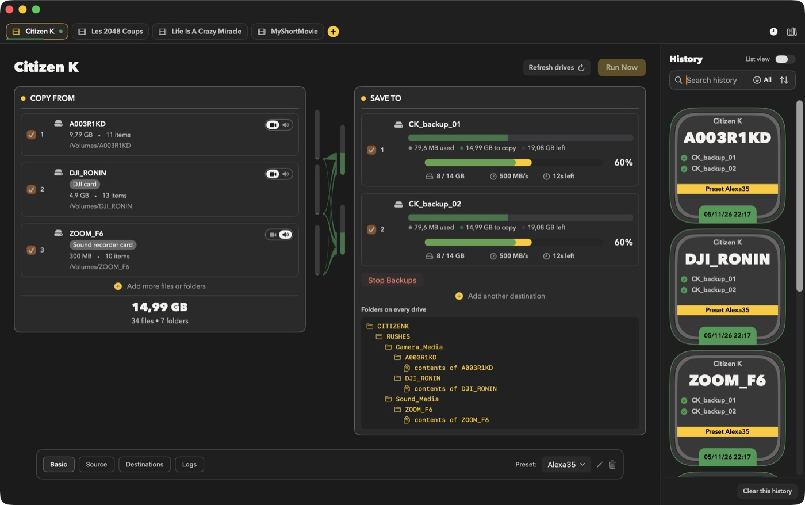
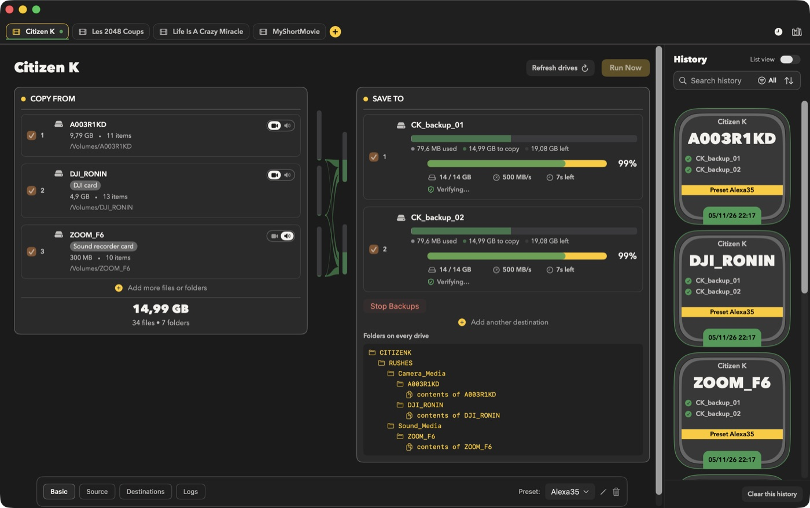

<!-- lang:en -->
# Visualizations

Real-time transfer status.

---

## Before Transfer

- Source size and file count
- Destination capacity bar, left to right: used (grey), to copy (green), free (black), with a legend "X used · Y to copy · Z left"
- The resolved folder tree (**Folders on every drive**) showing where files will land
- Size indicators

---

## During Transfer

- Progress bars per destination
- Speed and estimated time
- Current file

---

## Yellow vs Green Bars

- **Yellow**: copy progress
- **Green**: verification progress (drawn over the yellow bar) (may stay empty if verification is off)

**Behavior**
- During copy, the yellow bar advances.
- If verification is enabled, the green bar advances as files are verified.
- A destination is fully done when the copy bar is complete (and the verification bar too, if verification is enabled).

---

## Status Colors

- **Green**: active or done
- **Orange**: paused
- **Gray**: pending
- **Red**: error

<!-- lang:fr -->
# Visualisations

Statut de transfert en temps réel.

---

## Avant transfert

- Taille de la source et nombre de fichiers
- Barre de capacité du disque destination, de gauche à droite : utilisé (gris), à copier (vert), libre (noir), avec une légende « X used · Y to copy · Z left »
- L'arborescence résolue (**Folders on every drive**) qui montre où iront les fichiers
- Indicateurs de taille

---

## Pendant le transfert

- Barres de progression par destination
- Vitesse et temps estimé
- Fichier actuel

---

## Barres jaunes vs vertes

- **Jaune** : progression de la copie
- **Vert** : progression de la vérification (par-dessus la barre jaune) (peut rester vide si la vérification est désactivée)

**Comportement**
- Pendant la copie, la barre jaune avance.
- Si la vérification est activée, la barre verte avance au fur et à mesure que les fichiers sont vérifiés.
- Une destination est entièrement terminée lorsque la barre de copie est complète (et aussi la barre de vérification, si la vérification est activée).

---

## Couleurs de statut

- **Vert** : actif ou terminé
- **Orange** : en pause
- **Gris** : en attente
- **Rouge** : erreur

<!-- lang:de -->
# Visualisierungen

Echtzeitübertragungsstatus.

---

## Vor Übertragung

- Quellgröße und Dateianzahl
- Kapazitätsbalken des Ziellaufwerks, von links nach rechts: belegt (grau), zu kopieren (grün), frei (schwarz), mit Legende „X used · Y to copy · Z left“
- Der aufgelöste Ordnerbaum (**Folders on every drive**), der zeigt, wohin die Dateien kommen
- Größenindikatoren

---

## Während Übertragung

- Fortschrittsbalken pro Ziel
- Geschwindigkeit und geschätzte Zeit
- Aktuelle Datei

---

## Gelbe vs. grüne Balken

- **Gelb** : Kopierfortschritt
- **Grün** : Verifizierungsfortschritt (über dem gelben Balken) (kann leer bleiben, wenn Verifizierung aus ist)

**Verhalten**
- Während des Kopierens schreitet der gelbe Balken voran.
- Wenn die Verifizierung aktiviert ist, wird der grüne Balken vorangebracht, während Dateien verifiziert werden.
- Ein Ziel ist vollständig erledigt, wenn der Kopierbalken vollständig ist (und auch der Verifizierungsbalken, wenn Verifizierung aktiviert ist).

---

## Statusfarben

- **Grün** : aktiv oder fertig
- **Orange** : angehalten
- **Grau** : ausstehend
- **Rot** : Fehler

<!-- lang:es -->
# Visualizaciones

Estado de transferencia en tiempo real.

---

## Antes de transferir

- Tamaño de origen y número de archivos
- Barra de capacidad del destino, de izquierda a derecha: usado (gris), por copiar (verde), libre (negro), con leyenda «X used · Y to copy · Z left»
- El árbol de carpetas resuelto (**Folders on every drive**) que muestra dónde irán los archivos
- Indicadores de tamaño

---

## Durante la transferencia

- Barras de progreso por destino
- Velocidad y tiempo estimado
- Archivo actual

---

## Barras amarillas vs verdes

- **Amarillo** : progreso de copia
- **Verde** : progreso de verificación (sobre la barra amarilla) (puede permanecer vacío si la verificación está desactivada)

**Comportamiento**
- Durante la copia, la barra amarilla avanza.
- Si la verificación está habilitada, la barra verde avanza a medida que se verifican los archivos.
- Un destino se completa cuando la barra de copia está completa (y también la barra de verificación, si la verificación está habilitada).

---

## Colores de estado

- **Verde** : activo o completado
- **Naranja** : pausado
- **Gris** : pendiente
- **Rojo** : error
